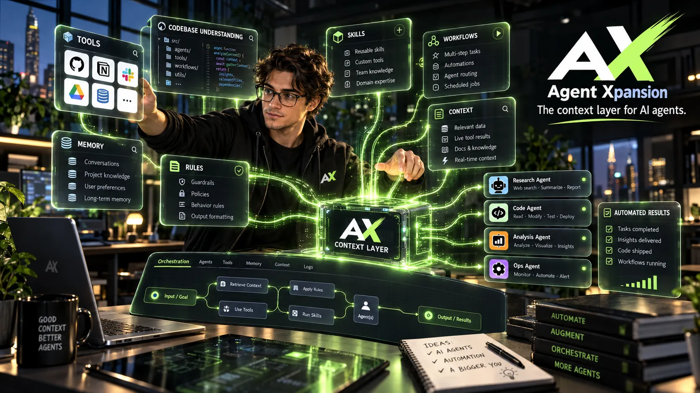
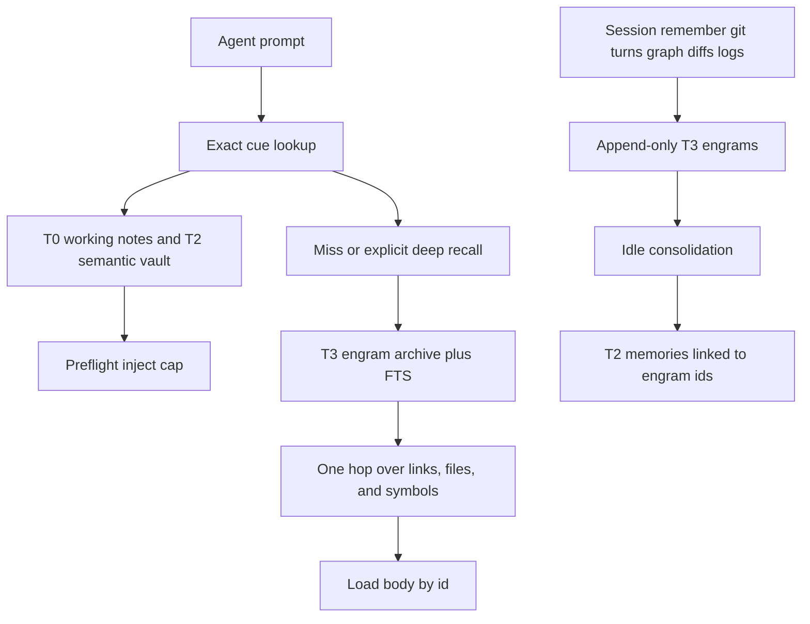
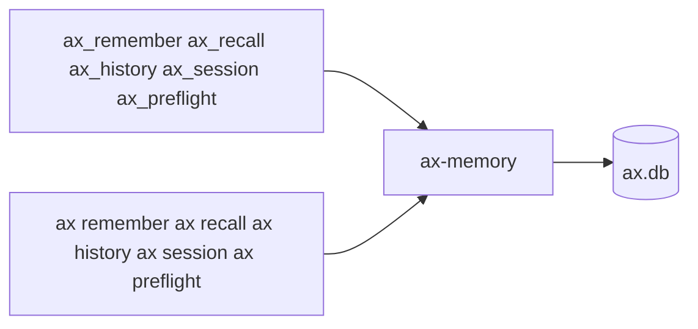
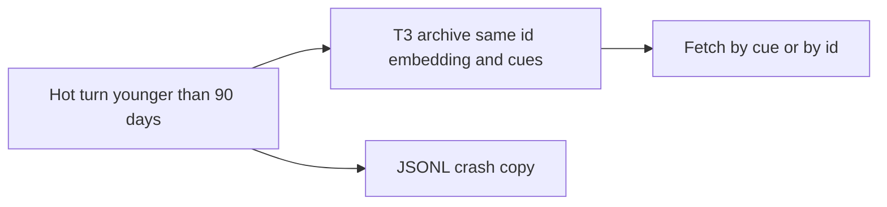

# ax

## Your context. Your rules. Your control.

Local-first code intelligence, persistent memory, MCP integration and policy-driven development. One native binary.

[](https://github.com/GaryWenneker/ax/releases/latest)
[](https://getax.wenneker.io)
[](https://github.com/GaryWenneker/ax/actions/workflows/dependency-monitor.yml)

Open source, MIT, native Rust. No cloud index and no API keys. The source stays on your machine unless you explicitly publish Command Center or enroll a project in replication.

| Layer | What it does |
|---|---|
| **Knowledge graph** | Tree-sitter parsing into a SQLite index of symbols, calls, imports, and routes |
| **Memory** | Working notes, named long-term memories, and a permanent archive bound to the code graph. [Memory](#memory) |
| **Policy engine** | IDE-agnostic rules and skills in `.agents/`, matched and injected each turn |
| **Command Center** | Policy, memory, graph, quality gates, token savings, MCP Logging and Quality, draft PRs |
| **CLI-only mode** | Same preflight/session/durable/turn engines without MCP, plugins, hooks, or daemons (`ax install --mode cli-only`) |

Agents query structure through MCP (`ax_explore`, `ax_preflight`, and the rest) or the matching CLI commands. The documentation describes the current source. Published binaries follow the [latest release](https://github.com/GaryWenneker/ax/releases/latest). [Build from main](https://getax.wenneker.io/getting-started/installation/#build-from-main) when you need source that is newer than that release.

Full introduction: [getax.wenneker.io](https://getax.wenneker.io/getting-started/introduction/).

## Quick start

```bash
# macOS / Linux
curl -fsSL https://getax.wenneker.io/install.sh | sh

# Windows (PowerShell)
irm https://getax.wenneker.io/install.ps1 | iex
```

Have Node? `npx @garywenneker/ax` downloads the native binary. Open a new terminal so `PATH` updates. WSL2 uses the Linux command inside WSL.

```bash
ax install                 # wire MCP into detected agents
# ax install --mode cli-only   # instruction surfaces for all IDEs, no MCP/hooks
cd your-project && ax init # required in each directory where you want to use ax
ax web --open              # local Command Center
```

After `ax install`, run `ax init` in each directory where you want to use ax. `ax init --all` only refreshes directories that already contain `.ax/ax.db`. It does not set up a new directory. Prebuilt releases ship six binaries: Windows x64/arm64, macOS Intel/Apple Silicon, Linux x64/arm64.

The shell installer saves the binary directory in your shell's startup configuration. Open a new terminal after installation, or run the printed `export PATH=...` command in the current terminal. On macOS with zsh, it updates `${ZDOTDIR:-$HOME}/.zshrc` without replacing existing settings. If profile setup fails, it reports the file and manual recovery instructions.

Next: [Quickstart](https://getax.wenneker.io/getting-started/quickstart/) · [Installation](https://getax.wenneker.io/getting-started/installation/) · [Your first graph](https://getax.wenneker.io/getting-started/your-first-graph/).

## Documentation

The site is the product guide. This README follows that map.

### Getting started

- [Introduction](https://getax.wenneker.io/getting-started/introduction/)
- [Quickstart](https://getax.wenneker.io/getting-started/quickstart/)
- [Installation](https://getax.wenneker.io/getting-started/installation/)
- [Configuration](https://getax.wenneker.io/getting-started/configuration/)
- [Your first graph](https://getax.wenneker.io/getting-started/your-first-graph/)
- [Next steps](https://getax.wenneker.io/getting-started/next-steps/)

### Core concepts

- [How it works](https://getax.wenneker.io/core-concepts/how-it-works/)
- [The knowledge graph](https://getax.wenneker.io/core-concepts/knowledge-graph/)
- [Resolution and frameworks](https://getax.wenneker.io/core-concepts/resolution/)

### Guides

- [Indexing a project](https://getax.wenneker.io/guides/indexing/)
- [Workspaces (monorepo)](https://getax.wenneker.io/guides/workspaces/)
- [Extractor plugins](https://getax.wenneker.io/guides/plugins/)
- [LSP enrichment](https://getax.wenneker.io/guides/lsp/)
- [Architecture insights](https://getax.wenneker.io/guides/architecture-insights/)
- [Open Knowledge Format](https://getax.wenneker.io/guides/okf/)
- [Policy engine](https://getax.wenneker.io/guides/policy-engine/)
- [Remote policy share](https://getax.wenneker.io/guides/policy-sharing/)
- [Framework routes](https://getax.wenneker.io/guides/framework-routes/)
- [Affected tests in CI](https://getax.wenneker.io/guides/affected-tests/)
- [Dependency lifecycle security](https://getax.wenneker.io/guides/dependency-lifecycle/)
- [Command Center](https://getax.wenneker.io/guides/command-center/)
- [Command Center walkthrough](https://getax.wenneker.io/guides/command-center-walkthrough/)
- [Desktop client](https://getax.wenneker.io/guides/desktop-client/)
- [Share Command Center](https://getax.wenneker.io/guides/share/)
- [MCP Logging and Quality](https://getax.wenneker.io/guides/mcp-quality/)
- [Memory vault](https://getax.wenneker.io/guides/memory/)
- [Obsidian vault](https://getax.wenneker.io/guides/obsidian-vault/)
- [Token savings](https://getax.wenneker.io/guides/token-savings/)
- [Smart Output](https://getax.wenneker.io/guides/smart-output/)
- [Standalone server and replicas](https://getax.wenneker.io/guides/standalone-ax/)
- [Remote MCP and OAuth](https://getax.wenneker.io/guides/remote-mcp/)
- [Expose Command Center with Cloudflare](https://getax.wenneker.io/guides/cloudflare/)
- [Agent budget](https://getax.wenneker.io/guides/budget/)
- [Pi integration](https://getax.wenneker.io/guides/pi/)

### Reference

- [MCP server](https://getax.wenneker.io/reference/mcp-server/)
- [Integrations](https://getax.wenneker.io/reference/integrations/)
- [CLI](https://getax.wenneker.io/reference/cli/)
- [Command Center HTTP API](https://getax.wenneker.io/reference/web-api/)
- [Rust API](https://getax.wenneker.io/reference/api/)
- [Languages](https://getax.wenneker.io/reference/languages/)
- [Troubleshooting](https://getax.wenneker.io/troubleshooting/)

## Memory

A name fetches the exact memory. The raw episode stays. Recall is bound to the code graph. It stays in local SQLite. MCP and the CLI do the same thing.



```mermaid
flowchart LR
  subgraph write [Write]
    session[ax session]
    remember[ax remember with trigger]
    git[git capture]
    turns[turn end]
    graph[graph diff on sync]
    logs[selected activity]
  end
  db[(ax.db)]
  session --> db
  remember --> db
  git --> db
  turns --> db
  graph --> db
  logs --> db
  db --> cue[Cue lookup]
  cue --> preflight[Capped preflight]
  cue --> archive[Archive recall]
```





Working notes stay in `ax session` (MCP: `ax_session`). They do not enter the vault. A durable decision is `ax remember --trigger NAME` (MCP: `triggers`). Fetch that name with `ax recall --cue` before exploring. An unknown name returns nothing. Free text is the fallback.

Recent turns stay hot for 90 days, then move to the archive with the same id. Git commits, folder documents, graph diffs, and selected activity are written straight into that archive. Preflight injects at most three long-term titles and stops at 6000 characters. It never injects the archive. Old graph changes, logs, and turns are `ax recall --depth archive` and `ax history --depth archive`. That search takes one hop over a link, a shared file, or a shared symbol. An open file raises a long-term memory that names that file or a symbol in it.

A turn or a commit that states a decision becomes a candidate. Confirm it with `ax remember --confirm` (MCP: `action=confirm`). The old episode stays. A near-duplicate is linked, not deleted. Embeddings stay local, two models are never mixed, and sync rewrites rows after a model change.

The long guide is [Memory](https://getax.wenneker.io/guides/memory/).

## What the site covers

The [docs](https://getax.wenneker.io/) follow the same product. These are the parts worth knowing before you read a single page:

- **Context.** A tree-sitter graph of symbols, calls, imports, and routes, queried through MCP instead of searching the tree. [How it works](https://getax.wenneker.io/core-concepts/how-it-works/), [architecture insights](https://getax.wenneker.io/guides/architecture-insights/), and [affected tests](https://getax.wenneker.io/guides/affected-tests/).
- **Rules.** IDE-agnostic rules and skills in `.agents/`, injected each turn. Share them over git or OneDrive. [Policy engine](https://getax.wenneker.io/guides/policy-engine/), [remote policy share](https://getax.wenneker.io/guides/policy-sharing/).
- **Memory.** Named cues, a capped preflight, and a permanent archive of turns, git captures, folder docs, graph diffs, and logs. [Memory](https://getax.wenneker.io/guides/memory/). The same notes open in Obsidian over WebDAV, with no note files on disk. [Obsidian vault](https://getax.wenneker.io/guides/obsidian-vault/).
- **Command Center.** Local UI for policy, memory, the graph, MCP Logging and Quality, and savings. Optional sign-in, passkeys, and member roles. A native desktop client embeds the same UI. [Command Center](https://getax.wenneker.io/guides/command-center/), [walkthrough](https://getax.wenneker.io/guides/command-center-walkthrough/), [desktop](https://getax.wenneker.io/guides/desktop-client/).
- **Reach.** Authenticated remote MCP for another IDE or ChatGPT, a primary and replicas across machines, a LAN share, or a Cloudflare tunnel onto the local server. [Remote MCP](https://getax.wenneker.io/guides/remote-mcp/), [replicas](https://getax.wenneker.io/guides/standalone-ax/), [Cloudflare](https://getax.wenneker.io/guides/cloudflare/).
- **Cost.** Compact replies, a project token budget for optional context, and a local monthly agent budget that quotes usage without blocking the provider. The Savings page counts MCP graph calls and the CLI commands that share those tools (`ax explore`, `ax query`, `ax node`, and the other twins). [Smart Output](https://getax.wenneker.io/guides/smart-output/), [token savings](https://getax.wenneker.io/guides/token-savings/), [agent budget](https://getax.wenneker.io/guides/budget/).

## What you get locally

Each indexed project gets a `.ax/` directory: `ax.db` (graph, FTS5, policy), `ax.json`, and `ship.toml`. Team rules and skills live in `.agents/` and reach the agent through MCP, not by reading those files on disk.

Command Center (`ax web`) is the local UI for that project: rules and skills, memory, the graph, Logging, quality gates, and Settings. Optional sign-in, passkeys, and member roles are configured under Settings when you want a published web origin. Remote MCP adds authenticated HTTPS access. Replication shares an enrolled project’s graph, memory, and policy between a primary and replicas. A Cloudflare tunnel can publish the local Command Center without opening the ax port on the public internet. Those flows are documented on the pages linked above.

Sharing a docs URL previews that page. The site build screenshots it and stamps the CLI source version from `Cargo.toml` on the card.

## Development

```bash
cargo test
cargo build --release -p ax-cli
./target-dev/release/ax --version
```

Cargo writes to `target-dev/`, not `target/debug/`. Maintainer notes for releases, the docs site, and the telemetry worker are in [docs/PRODUCTION.md](docs/PRODUCTION.md).

Dependabot proposes dependency updates. A separate monitor audits Rust and npm lockfiles. Safe npm fixes can be opened as review-only pull requests after a 7-day release-age gate. PHP scripts are the exception: they must run the latest stable PHP from php.net, with no 7-day wait. Nothing is merged or deployed automatically. Details: [Dependency lifecycle](https://getax.wenneker.io/guides/dependency-lifecycle/).

## License

See the repository license file.

<sub>AX · AgentXpansion</sub>
