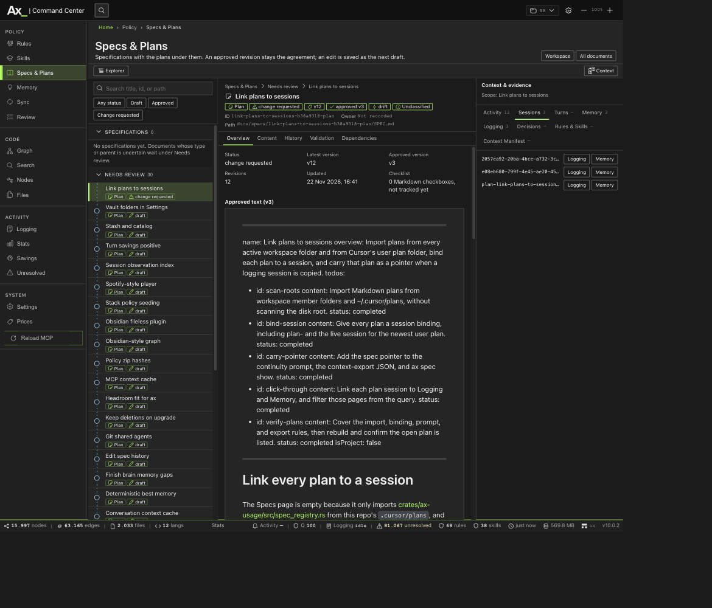
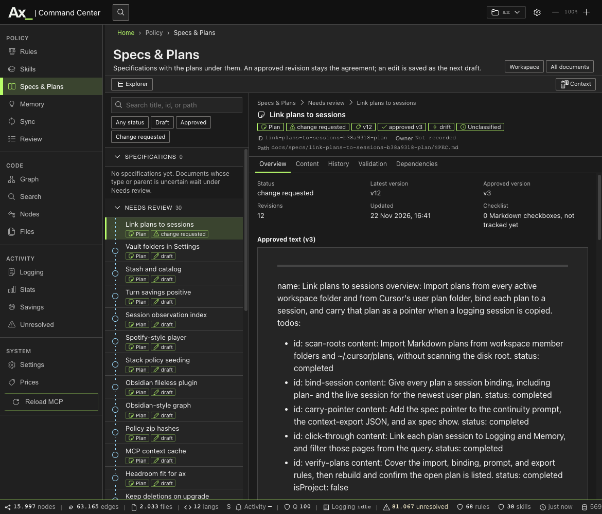
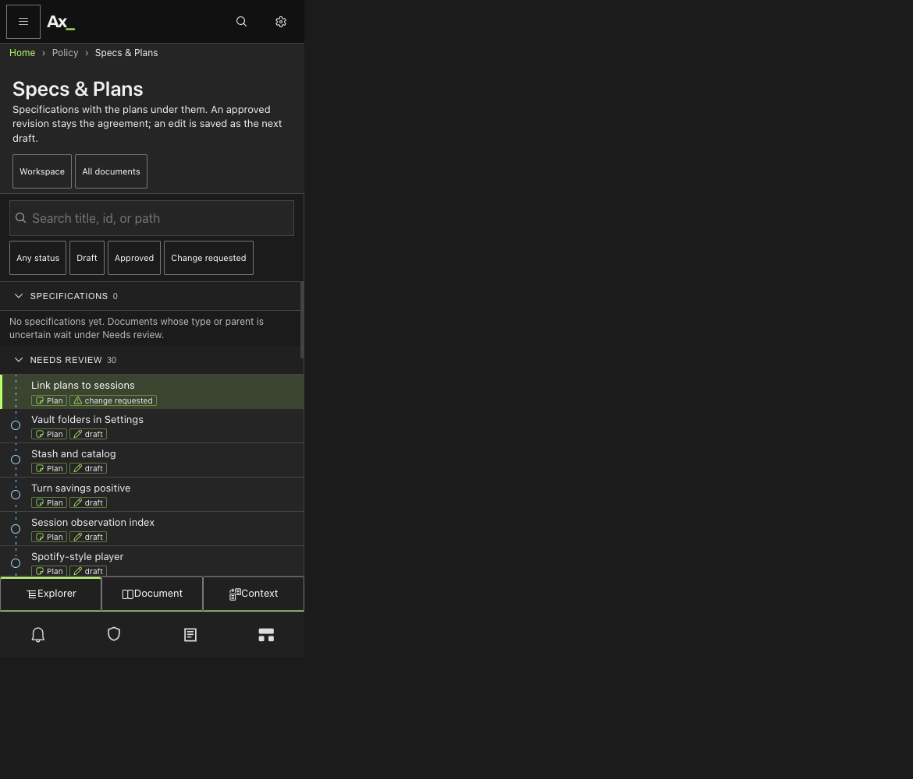
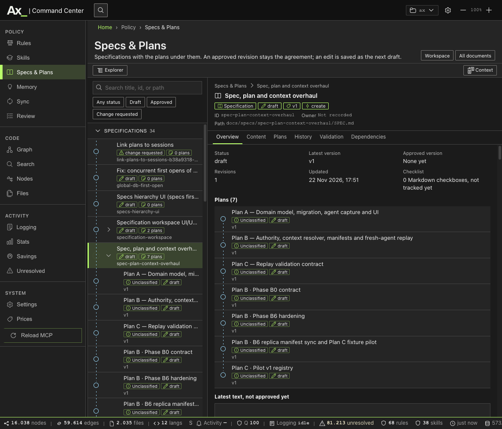

# Evidence — Phase 2A, the workspace view

Spec: [PHASE-2A-WORKSPACE-VIEW.md](PHASE-2A-WORKSPACE-VIEW.md), derived from the accepted [SPEC.md](SPEC.md). No separate approval of the slice text. Tier 2. Isolation: none (main tree), because the work builds on the uncommitted overhaul. Nothing committed.

## Outcome

`/specs` now opens the "Specs & Plans" workspace. The sidebar and header use that name. On wide screens three panes show: explorer, document, and context and evidence. The old flat list is the "All documents" view. The live server on port 7070 already serves the new bundle, because it reads `dist` from disk.

The live project has no specifications with stored plans yet. All 30 documents are plan-mode captures without a parent, so they show under Needs review, as criterion 10 requires.

## Behaviors

| # | Check | Result |
| --- | --- | --- |
| W1 | `specsPage.test.ts` (nav label) and `specSession.test.ts` (nav order) | pass. Both expected `'Specs'`; the label assertions were changed to `'Specs & Plans'` under owner decision 4. The `specsPage` one was observed failing first; the order and the ids are still asserted. |
| W2, W7, W8, W10 | `specWorkspacePage.test.ts`, 7 tests | pass; all 7 were observed failing against an empty component first |
| W3 to W6, W11, W13 | `specWorkspace.test.ts`, 12 tests | pass; all 12 were observed failing against a stub that throws |
| W9 | browser, live project | Sessions, Logging, and Memory tabs list the three bound sessions of "Link plans to sessions", each with Logging and Memory buttons. Explorer rows have none. |
| W12 | browser at 1440, 1024, and 390 px; `specWorkspacePage.test.ts` breakpoint test | pass. The first breakpoint (1200 px) hid the explorer at 1024 px. W12 was revised visibly, the test was changed and observed failing, then the CSS was changed. |

## Checks, one run after the last code edit

| Check | Result |
| --- | --- |
| `npm test` in `crates/ax-web/web-ui` | 87 tests, 87 pass, 0 fail |
| `npx tsc --noEmit -p .` | exit 0 |
| `npm run build` | exit 0; bundle `index-CN3tuh9h.js`; the chunk-size warning was already there |
| `cargo build --release -p ax-cli` | exit 0; the binary embeds `index-CN3tuh9h.js`, the file `dist/index.html` names |
| Served on 7070 | `index-CN3tuh9h.js` |
| No writes on page load (must-not) | live `.ax/ax.db` before and after browsing: 173 schema objects, 30 `specs` rows, 41 `spec_revisions` rows |

## Must not

- Writes on page load: none, per the check above.
- The current list still works in All documents. `specsPage.test.ts` passes; its only changed assertion is the nav label.
- No fabricated parent, phase, or alternative: tests W4 and W5. In the browser, every live document shows under Needs review, and plans read "Unclassified".
- Calm list primitives (`ItemList rows`, `ItemRow variant="graph"`, `ItemGroupHeader`) and outline badges are used. The inline "New alternative plan" form is now `ModalShell` in both views.
- No new dependency: `package.json` gained two test files in its test script and nothing else.

## Not done

- **Review loop:** the `review-loop` round with the `typescript-review` and `react-review` skills has not run.
- **Mutation testing:** none was run for `specWorkspace.ts`.
- **Playwright:** no end-to-end test exists for the workspace yet.
- **Not built in this slice:** resizable panes (collapse only), stored relation types, checklist tracking, filters by document id with a return link, historical mode, triage actions, and spec and plan titles from the server in hierarchy mode (the explorer shows ids there).
- **Front matter:** a document body that starts with YAML front matter shows that front matter as text in the Overview preview. This is how `MarkdownPreview` renders it everywhere.

## Addendum — the chat's specs and plans, classification, and selecting a spec

The owner asked on 2026-11-22:

- to treat the 30 plan-mode documents as specifications ("They are specifications");
- to add the specs shared in this chat with their plans ("dat moet je voor mij gewoon toevoegen");
- to see a spec's plans on selecting it;
- to see one specification with several plans.

**Code:**
- `crates/ax-usage/src/spec_documents.rs`: an append-only classification table, created only on a write; stored plans per spec in the list; plan-less import.
- New list fields `plans` and `detectedKind`.
- `POST /api/specs/import` and `POST /api/specs/classify`, with CLI `ax spec-import` and `ax spec-classify`.
- In the UI: plans nest under their spec, selecting a spec unfolds it, its Overview lists "Plans (N)", and specifications are sorted newest first, like the old list.

**Tests:**
- `cargo test -p ax-usage --lib`: 348 passed, 1 ignored. All 5 new tests were observed failing first, except `listing_creates_no_classification_table`. That one passed at once and was then proven with a throwaway change that made reads create the table: the test failed, and the change was reverted.
- `npm test`: 91 of 91 pass. The four new UI tests were each observed failing first: nesting, unfold on open, overview plans, and newest first.
- `tsc` exits 0.

**Data:** `scripts/import-chat-specs.py` ran first against a `.backup` copy of the live database. All 12 commands answered ok, and the list showed 34 documents, all specifications. It then ran against the live project:

| Table | Before | After |
| --- | --- | --- |
| `specs` | 30 | 34 |
| `spec_revisions` | 42 | 46 |
| `plans` | 0 | 9 |
| `plan_revisions` | 0 | 9 |
| `spec_document_types` | none | 30 rows |

Provenance is this chat's session id and the current turn id from `.ax/turns/current.json`. The live server on 7070 was restarted on the new binary, because the old binary lacked the new list fields.

**Not done:**
- MCP tools for `spec-import` and `spec-classify`.
- Stored relation types. Plans read "Unclassified"; the titles name Plan A, B, and C.
- The overhaul master's shown path is `docs/specs/spec-plan-context-overhaul/SPEC.md`, derived from its id; the file is `01-MASTER-SPEC.md`.
- The hierarchy UI addendum `REPLAY-ACTION.md` was not imported.
- The list's existing placeholder session binding (`plan-<id>`) now also appears on the four new specs.
- The review loop, mutation testing, and Playwright are still open.
