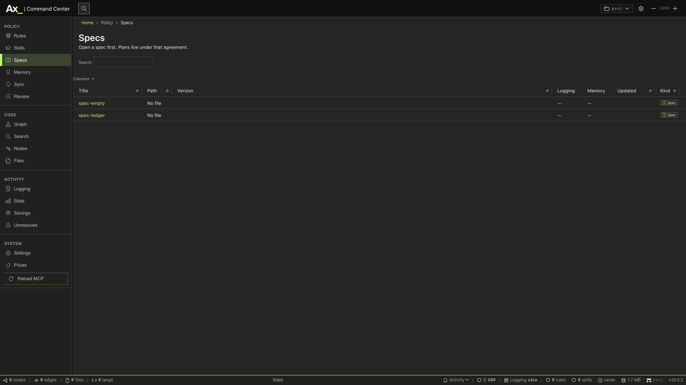
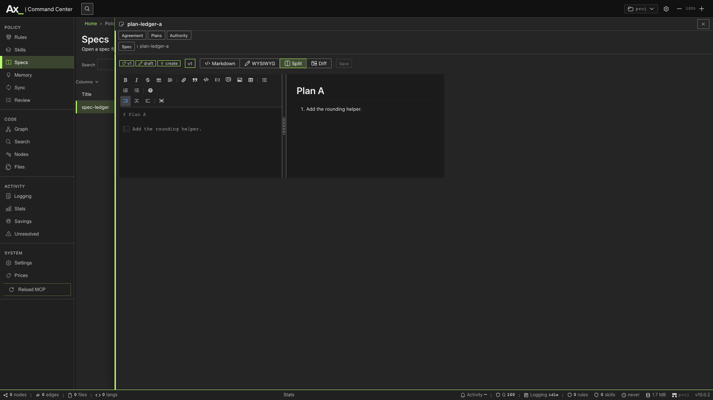
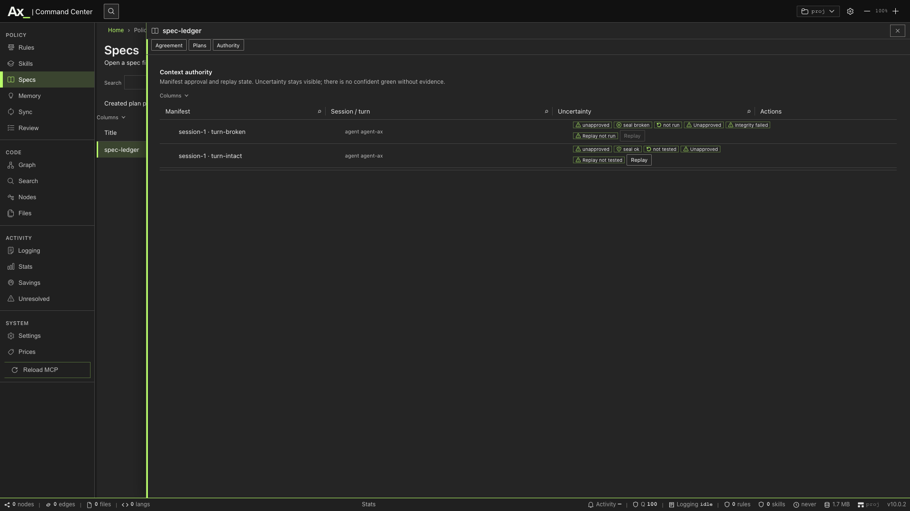

# EVIDENCE — Specs hierarchy UI (specs first, then plans)

Tier 2. Spec approval: owner “do it, you must”, which came before the clarification “first hierarchy specs, from there the plans” that the spec is built on; the revised spec was implemented on “implement and continue.” There is no sign-off of the final text (`/Users/gary/io/ax/docs/specs/specs-hierarchy-ui/SPEC.md`).

Rechecked on 2026-11-22 against `SPEC.md` (14 behaviors) and `REPLAY-ACTION.md` (5 behaviors). The behavior-by-behavior map, the browser walkthrough, mutation testing, and the final gauntlet numbers are in `/Users/gary/io/ax/docs/specs/spec-plan-context-overhaul/EVIDENCE-RECHECK.md`.

## Spec → test map

| Behavior | Check |
|---|---|
| List shows specs only | `hierarchySpecRows shows specs only so plans stay under the opened spec`; mutant M25 |
| Plans under the opened spec (unknown spec gives `[]`) | same test; mutant M26 |
| Plan revision history API | `list_plan_revisions_returns_ordered_history` |
| Saving a plan appends a draft and keeps the approved revision | `revising_an_approved_plan_appends_a_draft_and_keeps_the_approved_row`; mutants M23, M24 |
| Payload parsing (legacy and hierarchy) | `a flat spec payload stays a flat list`, `a hierarchy payload lists the spec and then its plan without the body` |
| Replay action (REPLAY-ACTION.md) | `EVIDENCE-RECHECK.md`, section "REPLAY-ACTION.md" |
| Embed matches dist | the final release build embeds `index-CmAv1Egz.js`, the file `dist/index.html` names (only the two recheck scripts changed after it) |

Behaviors 3 to 9, 12 and 13 (page wiring, tabs, breadcrumb, deep links, closing the blade, the Plans tab, alternative plans, panel placement) have no unit test, and the test for behavior 14 (legacy mode) covers only the list data. They are covered by the walkthrough; the result for each behavior is in `EVIDENCE-RECHECK.md`.

## Gauntlet

```bash
bash /Users/gary/io/ax/scripts/spec-recheck-gauntlet.sh
```

Final numbers: `EVIDENCE-RECHECK.md`, section "Gauntlet". It includes `npm test` (with `hierarchyList.test.ts`), `tsc --noEmit`, coverage of `hierarchyList.ts` (100% lines and functions; branch coverage is lower only in the payload parser), and mutants M23 to M26 for this spec. An earlier version of this file reported 3 passing tests, skipped mutation and coverage, and named the bundle `index-DEwIWHUF.js`.

## Walkthrough

A temporary project with an isolated home and global database (`ax-walkthrough.ARymHlXm2w` in the OS temp folder), with `hierarchy_v2` on in that database only. The live project was not touched, and `hierarchy_v2` is still off there.

The list with an empty search, served by the final release binary: one row per spec, including `spec-empty`, which has no plans, and no plan rows.



A plan opened under its spec, with the `Spec › plan-ledger-a` breadcrumb:



The Authority tab: the Replay button is disabled for the manifest with a broken seal and enabled for the intact one:



## Known limits

- Hierarchy blade tabs appear only when `/api/specs` returns `mode: "hierarchy"` (flag on).
- Plan approve via membership is not in this UI pass; plan drafts are editable/savable only.
- The list shows the spec id instead of its title and leaves the Version column empty; the authority panel shows overlapping uncertainty badges; on first load the page briefly shows the legacy layout before the hierarchy data arrives. Raised in `EVIDENCE-RECHECK.md`, "Spec issues for the owner".
- Independent verification: not performed.
