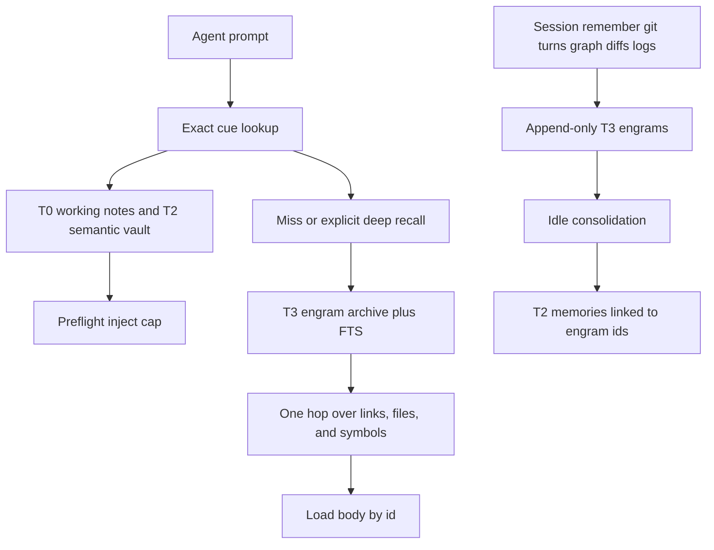
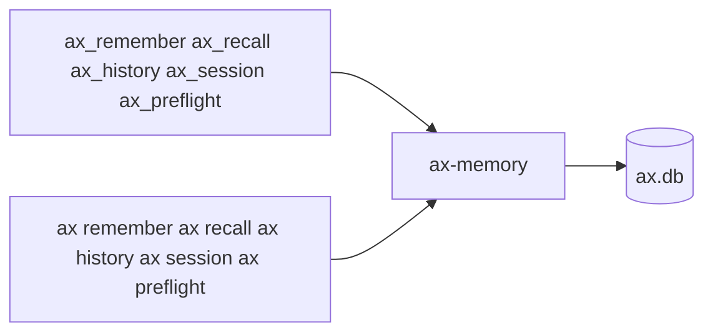
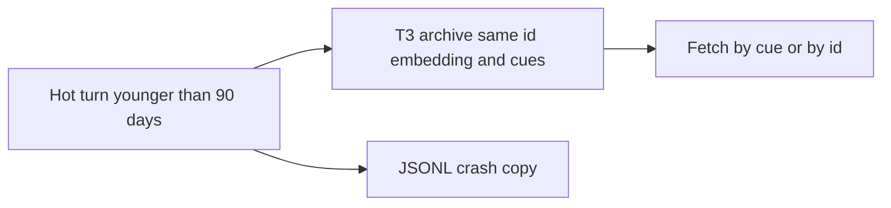

ax keeps a brain-style memory in the same local SQLite database as the code graph. A name fetches the exact memory. The raw episode stays. Recall is bound to the live graph. MCP and the CLI call one function, so neither surface is a subset.

## What ax remembers

There are five tiers. Forgetting moves a memory down. It does not erase it.

**Working notes** are this chat only. `ax session` and `ax_session` hold the objective, the facts, and the open questions. They do not enter the vault.

**Recent turns** are the last 90 days of agent work. Preflight can show related turn history. A turn is not a durable decision.

**Long-term memory** is a decision, a bug fix, an architecture note, a convention, or a note. Store it with a trigger name. Preflight injects at most three titles, and that block stops at 6000 characters. If the prompt contains a registered name, that memory comes first. An unknown name returns nothing. Free text is only the fallback, for a paraphrase.

**The archive** is permanent. These rows are never injected:

- a turn older than 90 days, demoted with the same id, embedding, and cues
- a git commit captured from history
- a folder document synced into the vault
- a graph diff written on sync: a symbol added, removed, or signature-changed, plus its file
- selected activity for memory, policy, ship, and sync. High-volume token traces are skipped

Fetch an archive row by name, by id, or with `depth=archive`. That search uses full text plus a local vector index, then takes one hop over a memory link, a shared file, or a shared symbol cue. A row with none of those stays out.

**The code graph** stays the map. A memory stores file paths and symbol names. It does not copy the graph. When a file is open, a long-term memory scores higher if that file, or a symbol defined in it, is on the memory.

A JSONL file written at demotion is a crash copy. Search uses the database.

A turn or a commit that states a decision becomes a **candidate** long-term memory, linked to the source episode. Preflight skips the candidate until a second source agrees, or you confirm it. The original episode stays in the archive. A near-duplicate (cosine at least 0.80) gets a supersedes link. The old body stays.

Embeddings stay on this machine. The default is a local hash (`hash-v1`). An optional ONNX MiniLM model (`minilm-256`) can replace it. There is no cloud embedding API. Recall never compares two models. After a model change, sync rewrites the old rows in the background.

### How to use it

1. Keep facts for this chat in `ax session` (MCP: `ax_session`). They do not go into the vault.
2. Store a durable decision, fix, or convention with `ax remember --trigger NAME` (MCP: `triggers`). The name can be repeated.
3. Before re-deriving it, fetch that name with `ax recall --cue NAME` (MCP: `cue`). If you name the trigger, that fetch comes before explore. Free-text recall is the fallback.
4. For an old graph change, a log, or a past turn, use `ax recall --depth archive` and `ax history --depth archive` (MCP: `depth=archive` on both). Preflight will not contain those hits. `ax recall --id ID` returns the full body and its cues.
5. Confirm a candidate with `ax remember --confirm ID` (MCP: `action=confirm` and `id`). The old episode stays.

On the Command Center Memory page, every row shows its tier: working, recent, long-term, or archive. Turn on Archive to search the permanent tier. A hit from that search is also marked recalled from archive.


## Tiers



| Tier | What it holds | Injected |
|---|---|---|
| T0 | Working notes for this chat (`ax_session` / `ax session`) | Yes, as the session snapshot |
| T1 | Recent turns | Only related turn history, not the memory block |
| T2 | Decisions, fixes, architecture, conventions, notes | At most 3 titles, 6000 characters. A cue hit comes first |
| T3 | Demoted turns, git captures, graph diffs, selected activity, folder docs | Never. Fetch by cue, id, or `depth=archive` |
| T4 | The live code graph | Queried, not copied into a memory |

## Write path and read path

```mermaid
flowchart LR
  subgraph write [Write]
    session[ax session]
    remember[ax remember with trigger]
    git[git capture]
    turns[turn end]
    graph[graph diff on sync]
    logs[selected activity]
  end
  db[(ax.db)]
  session --> db
  remember --> db
  git --> db
  turns --> db
  graph --> db
  logs --> db
  db --> cue[Cue lookup]
  cue --> preflight[Capped preflight]
  cue --> archive[Archive recall]
```

## MCP and CLI



`triggers` and `--trigger` store a name. `cue` and `--cue` fetch it. `depth=archive` and `--depth archive` search the archive. `action=confirm` and `--confirm` enable a candidate. The JSON keys match.

## Demotion



A turn older than 90 days leaves the hot set. It is not deleted. Preflight does not inject it. `ax_recall` / `ax recall --id` and `--cue` still return it.

ax also keeps decisions, bug fixes, architecture notes, and conventions that agents should not re-discover from scratch. Memories live in `.ax/ax.db`, work fully offline, and the current tier is what preflight may inject.

You can also read and edit memories, rules, and skills in Obsidian: `ax web` serves them as a WebDAV drive. See [Obsidian Vault](/guides/obsidian-vault/).

## Why Memory matters

Without memory, every agent session starts from zero. An agent might re-derive a decision you already made, propose a pattern you already rejected, or miss context about why code was written a certain way. The memory vault closes that gap: it captures the **why** behind changes and replays it automatically when relevant.

## How it works — overview

```
INGEST (write path)                              RECALL (read path)
                                                  
git post-commit ──► ax capture-git ──┐            ax_preflight (every turn)
git post-merge  ──► ax capture-git ──┤              │
agent turn end  ──► ax turn-hook ────┤              │
CLI: ax remember ────────────────────┤              ▼
MCP: ax_remember ────────────────────┤  embed()   recall_for_prompt(prompt, 3)
UI: "New memory" ────────────────────┼──────►       │
                                     │            ┌─┴─────────────────────┐
                                  ax.db           │ FTS5 BM25 leg         │
                                  memories +      │ Vector cosine leg     │
                                  memories_fts    │ Reciprocal Rank       │
                                  + embedding     │ Fusion + decay(90d)   │
                                                  └───────────────────────┘
                                                    │
                                                    ▼
                                                  <ax_memories> block
                                                  injected into agent context
```

### Ingest paths

1. **Automatic — git commits.** Post-commit and post-merge hooks run `ax capture-git` after every commit. Non-trivial commit messages become `kind: git` archive memories linked to the files they touched. Preflight does not inject them. A commit that states a decision becomes a candidate until a second source or `--confirm` enables it. Trivial subjects (merges, bumps, WIPs, typos, formatting, anything under 12 characters) are skipped. IDs are derived from the commit hash (`git-{hash12}`) so re-running never duplicates.

2. **Automatic — agent turns.** In Cursor and Claude Code, every agent turn that changed files or made a commit becomes a local `kind: turn` memory with the prompt, the agent's final reply (the outcome), the files, and the commit subjects. Preflight gives related past turns back to the agent, and `ax_history` answers "when did I change X". See [Per-turn memories](#per-turn-memories).

3. **Manual — you or your agent.** Click "New memory" in the Command Center, run `ax remember` from the CLI, or let agents store knowledge by calling `ax_remember` via MCP. All three paths run duplicate detection after saving.

4. **Injected — every agent turn.** When an agent calls `ax_preflight` (mandatory at the start of every turn per ax policy), the user's prompt is matched against long-term memories. The top 3 titles are injected, and the block stops at 6000 characters. Archive rows stay out. An open file raises a long-term memory whose cue is a symbol in that file. `depth=archive` then takes one hop over a memory link, a shared file, or a shared symbol cue. A changed embedding model is rewritten in the background on sync.

## Memory kinds

| Kind | Use for |
|---|---|
| `decision` | Why the team chose X over Y |
| `bug_fix` | Root cause + fix of a non-obvious bug |
| `architecture` | Structural knowledge (boundaries, data flow) |
| `convention` | Team rules that are not lintable |
| `note` | Everything else (default) |
| `git` | Auto-captured from commit history |
| `turn` | Auto-captured per agent turn. Hot for 90 days, then demoted to the archive. A JSONL crash copy is written first. The row stays fetchable |

## The recall algorithm

Recall uses **hybrid search** — two independent ranking methods fused together, then weighted by time decay:

### Step 1 — FTS5 full-text search (lexical leg)

The query is tokenized, stop words are removed (English and Dutch), and each remaining token (minimum 3 characters) is quoted and joined with `OR`. This runs against a [FTS5](https://www.sqlite.org/fts5.html) virtual table that auto-syncs via triggers on every INSERT, UPDATE, and DELETE. Results are ranked by BM25.

### Step 2 — Vector similarity (semantic leg)

The query is embedded locally into a fixed 256-dimensional vector. **Default:** feature hashing (FNV-1a tokens + character trigrams) — no API calls, no model download. **Optional:** build with `--features onnx` and place a MiniLM `.onnx` at `AX_ONNX_MODEL` or `~/.ax/models/all-MiniLM-L6-v2.onnx` for dense neural embeddings (projected to 256-d for storage compatibility). Stored embeddings are compared via cosine similarity. Matches below 0.1 similarity are discarded. Legs are fused with weighted RRF (vector 0.5 / FTS 0.3 / graph 0.2 when an open file is on the memory). Hot rows stay an exact scan. Archive rows use sqlite-vec KNN. Recall never compares two embedding models. Each row stores `hash-v1` or `minilm-256`.

### Step 3 — Reciprocal Rank Fusion (RRF)

Both ranked lists are fused using standard [Reciprocal Rank Fusion](https://plg.uwaterloo.ca/~gvcormac/cormacksigir09-rrf.pdf) with k=60:

```
score(memory) = 1/(k + rank_fts + 1) + 1/(k + rank_vector + 1)
```

A memory that ranks high in both legs gets a strong combined score. A memory that only matches one leg still surfaces, but with a lower score.

### Step 4 — Confidence decay

The fused score is multiplied by the memory's **effective confidence**, which decays over time:

```
effective = confidence * 0.5 ^ (age_days / 90)
```

Confidence starts at 1.0 when a memory is created or updated. It halves every 90 days. This means:
- A 1-day-old memory retains ~99% of its confidence
- A 90-day-old memory retains ~50%
- A 180-day-old memory retains ~25%

Updating or re-saving a memory resets its confidence to 1.0. This prevents stale, outdated knowledge from dominating agent context while keeping fresh memories highly ranked.

## Automatic injection via `ax_preflight`

This is the mechanism that makes memories useful without agent action:

1. Every agent turn starts with `ax_preflight(prompt, files)` (mandatory per ax policy).
2. Preflight looks up a registered name first, then runs hybrid recall, and keeps at most 3 injectable memories. Archive rows and candidates are left out.
3. Matches with score <= 0.0 are filtered out.
4. Remaining matches are formatted as an `<ax_memories>` XML block (max 6,000 characters).
5. The block is appended to the inject string alongside policy rules.
6. Items that a delivered rule, skill, or memory links to with `[[...]]` are added too: one hop, at most five per turn (see [Linking rules, skills and memories](/guides/policy-engine/#linking-rules-skills-and-memories)). A linked memory joins the `<ax_memories>` block.

The agent receives titles and ids, not the full bodies. A body is a later `ax_recall` / `ax recall --id`. The block looks like this:

```xml
<ax_memories note="Project memories matched for this prompt. Titles only; call ax_recall with the id or title for a body.">
- mem_8f2a [decision] We use tiktoken o200k_base for token counts
- mem_11c4 [bug_fix] Sonar proxy strips Content-Encoding after decompression
</ax_memories>
```

The agent treats these as established context — it never has to ask "have we decided this before?" because the answer arrives automatically.

## Explicit recall via `ax_recall`

Besides automatic injection, agents can explicitly search memories when they need deeper history:

- **By name.** `ax_recall` with `cue`, or `ax recall --cue NAME`. Exact match, every tier, including a demoted turn. An unknown cue is empty.
- **By id.** `ax_recall` with `id`, or `ax recall --id ID`. Returns that row and its cues.
- **Free text.** `ax_recall` with `query` and `depth` (`hot` or `archive`), or `ax recall QUERY --depth hot|archive`. Hot skips the archive. Archive is only the archive, then one hop. Default depth is hot. `limit` defaults to 5.
- **History.** `ax_history` and `ax history --depth archive` list old turns, graph changes, and selected logs.
- **Command Center.** The Memory search box runs the same hot search. The Archive checkbox switches it to archive depth.

Use explicit recall when you want to check "have we solved this before?" with more results than preflight delivers.

## Contradiction detection

When a new memory is stored (via any path), ax runs `find_similar` with a cosine threshold of 0.80 against all existing memories. If near-duplicates are found:

- **MCP:** The response includes `similar[]` with the matching memories and a note asking the agent to check for contradictions.
- **CLI:** Prints "Similar existing memories (possible duplicate/contradiction)" with similarity percentages.
- **Command Center:** Shows a toast warning with the count of similar memories.

A near-duplicate is not deleted. Consolidation links it with `supersedes` and leaves the old body in the archive. Confirm the new candidate, or update the long-term row, when the decision has actually changed.

## The embedding model

The embedding model is entirely local — no API calls, no model files to download, fully deterministic across platforms:

- **Feature hashing:** Each word token is hashed (FNV-1a) into one of 256 dimensions with weight 2.0. Character trigrams (3-char sliding windows) are hashed with weight 1.0 for typo and morphology tolerance.
- **Sign randomization:** A second hash bit determines the sign of each feature, reducing collision bias.
- **L2 normalization:** The final vector is normalized to unit length, so cosine similarity equals the dot product.

Feature-hash embeddings give deterministic, typo-tolerant similarity that fuses well with FTS5. Optional ONNX dense embeddings replace `embed_text()` without changing the storage format (the 256-dim blob column stays the same). Command Center **Settings → Embeddings** shows the live backend (`hash` / `onnx` / `onnx_unconfigured`), Cargo feature flag, and model / tokenizer paths (`GET /api/memory/embed-status`). See [`docs/ONNX.md`](https://github.com/GaryWenneker/ax/blob/main/docs/ONNX.md).

## Storage schema

Everything is stored locally in `.ax/ax.db` (SQLite):

| Table | Purpose |
|---|---|
| `memories` | id, kind, title, body, tags, files, confidence, source, timestamps, embedding, `tier` (`t0`–`t3`), `embedding_model`, `status` (`active` or `candidate`) |
| `memories_fts` | FTS5 index of id, title, body, and tags, kept in sync by triggers |
| `memory_cues` | Normalized cue, memory id, weight, and source (`title`, `tag`, `trigger`, `symbol`, `file`) |
| `memory_links` | `source` and `supersedes` links between a candidate and the episode it came from |
| `memory_vec` | sqlite-vec index used only for archive search |

Triggers keep the FTS5 index in sync automatically on INSERT, UPDATE, and DELETE — no manual reindexing needed.

### Source field values

| Source | Created by |
|---|---|
| `manual` | CLI `ax remember` or Command Center "New memory" |
| `mcp` | Agent calling `ax_remember` via MCP |
| `git` | `ax capture-git` (hooks or manual) |
| `turn-hook` | `ax turn-hook` (Cursor / Claude Code agent turn hooks) |

## Git auto-capture

After `ax init`, git hooks are installed that capture memories automatically:

| Hook | Command | Behavior |
|---|---|---|
| `post-commit` | `ax capture-git --limit 1 --quiet` | Captures the latest commit |
| `post-merge` | `ax capture-git --limit 20 --quiet` | Captures recent merged commits |

The capture process:
1. Runs `git log --no-merges` with the specified limit
2. Parses each commit's hash, subject, body, timestamp, and touched files (up to 20 per commit)
3. Skips trivial subjects: anything under 12 characters, or starting with "wip", "merge", "bump", "typo", "format", or "lint"
4. Uses `INSERT OR IGNORE` with deterministic IDs (`git-{first 12 chars of hash}`), so re-running is idempotent
5. Git memories start at confidence 0.8 and are stored in the archive. Preflight does not inject them. A commit that states a decision becomes a candidate until you confirm it.

You can also run `ax capture-git` manually or click "Capture from git" in the Command Center to backfill history.

## Per-turn memories

`ax install` adds agent hooks next to the read-guard, for Cursor (`~/.cursor/hooks.json`) and Claude Code (`~/.claude/settings.json`). Run `ax install` again after upgrading to get the Cursor reply hook.

| Moment | Cursor | Claude Code | What runs |
|---|---|---|---|
| Turn start | `beforeSubmitPrompt` | `UserPromptSubmit` | `ax turn-hook start` saves a snapshot in `.ax/turns/`: the prompt (first 300 characters, secrets redacted), `HEAD`, and a content hash of every dirty file |
| Agent reply | `afterAgentResponse` | — | `ax turn-hook response` keeps the latest reply in the snapshot, secrets redacted |
| Turn end | `stop` | `Stop` (inside `ax stop-hook`) | `ax turn-hook end` compares the tree with the snapshot and writes one memory. Claude Code's reply comes from `last_assistant_message` |

Rules:

- **Only turns that did something.** Files whose content changed since the snapshot, new or deleted files, and commits made during the turn count. Files that were already dirty and not touched again do not, and neither do ax's own files under `.ax/` (database, logs, snapshots) except `.ax/policy/` and `.ax/memory/`. A turn that only answered a question writes nothing.
- **One memory per turn.** The id comes from the conversation and the turn (Cursor's `generation_id`, or a per-conversation counter for Claude Code), so a retried hook never duplicates.
- **With the outcome.** The memory ends with `Outcome:` and the agent's final reply, up to 20,000 characters (longer replies end with `[truncated]`). A turn without a captured reply has no outcome section.
- **Subagents don't end the turn.** Claude Code's `SubagentStop` still runs the policy check, but the turn memory waits for the main agent's `Stop`.
- **Given back while you work.** `ax_preflight` adds an `<ax_turn_history>` block with at most 3 related past turns, newest first: turns that changed a file passed in `files`, or turns that `ax_recall` finds for the prompt *and* that share at least 2 words of 4+ letters with it. Each line has the date, the prompt, the first 800 characters of the outcome, and up to 6 files. The block is at most 1,200 characters.
- **Local.** `turn` memories are still skipped by the `<ax_memories>` block, the memory titles list, and `ax memory export`.
- **Demoted after 90 days, backed up first.** Every turn end that writes moves `turn` memories older than 90 days to the archive. They are first appended to `.ax/backups/turn-memories-YYYY-MM-DD.jsonl`. If that write fails, nothing changes. The archived turn stays fetchable by id and by cue. Other kinds are never demoted by this job.
- **Change kind per file.** The memory body ends with a `Changes:` section (`A path`, `M path`, `D path`) so Command Center can color each file. Turns captured before this section existed only have `Files:` and show their files without a color.
- **Secrets redacted.** API keys (`sk-…`, `ghp_…`, `AKIA…`), `password=…` values, and long hex or base64 runs are stored as `[redacted]`.
- **Never blocks.** The hooks print nothing and always exit 0; outside a git repository or an ax project they do nothing.

The memory says *what* changed and what the agent reported, not *why*. Save the why with `ax_remember`.

### When did I change X?

`ax_history` (MCP) and `ax history` (CLI) list the turns and git commits that touched a file, a symbol, or a topic, newest first, with date and time, the prompt, the outcome (first 600 characters), the files, and the commits.

- A **file path** matches exactly or by its end (`review_language.rs` finds `crates/ax-core/src/review_language.rs`). `git log` for that path adds the commits.
- A **symbol name** resolves to the file it is defined in, then works like a path.
- **Anything else** is a topic: turns that `ax_recall` finds and that share a word with it.
- `since` (`--since`, `YYYY-MM-DD`) drops older entries. `id` (`--id`) shows one turn with its full outcome.

When a prompt asks "wanneer heb ik…", "when did I…" or "what did I change…", preflight adds an `<ax_history_hint>` telling the agent to call `ax_history`.

```bash
ax history review_language.rs
ax history resolve_review_language --since 2026-09-01
ax history --id turn-1a2b3c4d5e6f7a8b
```

To switch it off for a project, set this in `ax.json`:

```json
{ "memory": { "perTurn": false } }
```

`AX_NO_STOP_HOOK=1` switches it off (together with the Claude turn-end policy check) for one environment.

## CLI

```bash
# Store a decision
ax remember "We use tiktoken o200k_base for token counts; chars/4 was 30% off" \
  --kind decision --tag tokenizer --file crates/ax-usage/src/tokenizer.rs

# Search memories
ax recall "why tiktoken"
ax recall "tokenizer" --limit 10 --json

# Capture git history
ax capture-git --limit 100
ax capture-git --limit 1 --quiet    # same as the post-commit hook
```

See the [CLI reference](/reference/cli/#memory-vault) for all flags and options.

## MCP tools

Agents get two tools from the ax MCP server:

- **`ax_remember`** — store a memory (`body`, optional `title`, `kind`, `tags`, `files`). Source is set to `mcp`. The response includes similar existing memories so the agent can flag contradictions.
- **`ax_recall`** — free-text search returning scored matches and a formatted inject block.

Preflight injection means agents usually don't need to call `ax_recall` explicitly — relevant memories arrive with policy rules at turn start.

The MCP server's `initialize` response includes guidance for agents:

> *Memory vault: when you make a durable decision, fix a tricky bug, or establish a convention, store it with `ax_remember`. Use `ax_recall` to search past decisions before re-deriving them. Relevant memories are auto-injected via `ax_preflight`.*

## Command Center

The **Memory** page in the Command Center (`ax ship --watch` or `ax web`) provides:

- **Overview strip** — one compact row for how memories arrive (git, you or an agent, every turn) and the counts (total, git, manual/agent, search mode)
- **Memory vault list** — the main view: memories sorted by recency, with kind icons, age, tags, and source badges
- **Live hybrid search** — the search box runs the same recall algorithm agents use; scores shown per result
- **Detail blade** — click a memory to slide a panel in from the right. It scrolls on its own and shows the id, kind, source, enabled state, created and updated times, confidence, recall score, tags, the full text, linked files, commits, and outcome when those were stored. `[[links]]` in the text are clickable, and **Linked from** lists the rules, skills, and memories that link to this one
- **New memory modal** — composer with title, body, kind selector, and duplicate warning on save
- **Capture from git** — one-click button to mine recent git history

## Best practices

- **Store decisions, not facts.** "We use X because Y" is a good memory. "X is a library" is not — the agent can find that in code.
- **Include the why.** A memory saying "use tiktoken" is less useful than "use tiktoken o200k_base because chars/4 was 30% off on real prompts."
- **Link files.** Memories with file paths are more likely to surface when agents work on those files.
- **Clean up contradictions.** When a decision changes, delete or update the old memory. The duplicate warning helps, but periodic review keeps the vault sharp.
- **Let git hooks capture automatically.** After `ax init`, commit messages flow into the vault without manual steps. Write meaningful commit messages and they become agent context for free.
- **Use kinds.** Categorizing memories as `decision`, `bug_fix`, `architecture`, or `convention` helps both humans and recall ranking.

## Related

- [Policy Engine](/guides/policy-engine/) — rules and skills injected alongside memories
- [MCP server reference](/reference/mcp-server/) — `ax_remember` and `ax_recall` tool schemas
- [CLI reference](/reference/cli/#memory-vault) — `ax remember`, `ax recall`, `ax capture-git`

## Files, diffs, and images in Command Center

Open a memory on the **Memory** page to see its files and commits. A file row is green when the memory added it, orange when it edited it, and red when it deleted it. For git memories the kind comes from the commit; for turns it comes from the `Changes:` section. Hovering a row shows nothing. Click a file or a commit to open its diff with line numbers: added lines are green, removed lines red. **Close**, **Esc**, or a click outside the popup dismisses it; **Esc** closes only the popup, not the memory. The arrow icon at the end of a file row opens the file in your git host.

Images in the memory text render in the preview. An absolute local path such as `` is served through `GET /api/memory/{id}/image`; click an image to zoom in.

## Folder docs

Folders added under **Settings → Vault connection → Folders** with **Index into memory** on are imported as `doc` memories: one per `.md`, `.markdown`, or `.txt` file, tagged `folder:<name>`, with source `folder`. `ax_recall` finds them. Like turns, they are left out of preflight's memory titles and the git-shared memory export. See [Obsidian vault → Folders](/guides/obsidian-vault/#folders).

## Project boundaries and linked context

Working notes, durable transcripts and cached expansions belong to the active
canonical project. Reusing a session ID in another project does not transfer
those records. A context reset preserves durable notes while invalidating graph
reuse acknowledgements.

Preflight resolves wiki links using a lightweight ID/title catalog, then loads
only selected memory bodies by ID, capped at five linked items. The catalog still
scales with the number of titles; this is not a claim of constant-time lookup.
Use `ax_policy_index({ action: "audit" })` to review memory origins and body hashes
without exposing or altering their bodies. Background dedup is advisory: project
content is not automatically promoted to global policy.
